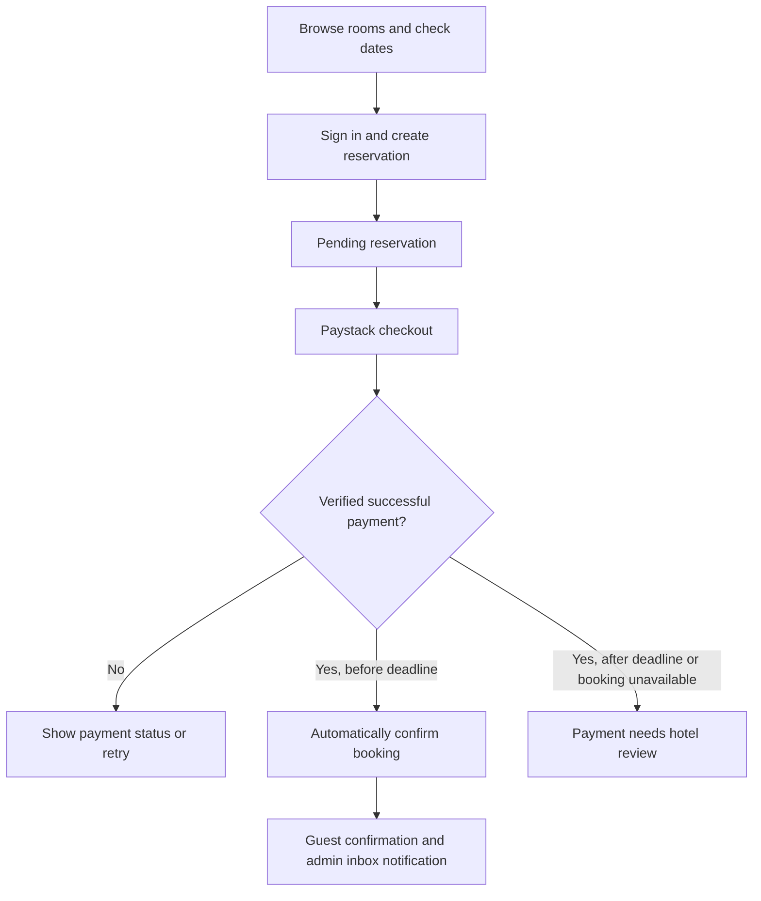

# Hotel Heaven

A full-stack hotel booking application for browsing rooms, planning a stay, paying online, and managing reservations in Polokwane, South Africa.

Built with **React, TypeScript, Redux Toolkit, Node.js, Express, and PostgreSQL**, with Google OAuth and Paystack integration. The interface uses a warm brown-and-cream palette, reusable components, and responsive layouts for guests and hotel administrators.

**[Visit the application](https://hotel-app-alpha-nine.vercel.app/)** · **[API health](https://hotel-heaven-api.onrender.com/api/health)** · **[API reference](backend/API.md)** · **[Deployment guide](DEPLOYMENT.md)**


## Contents

- [Project Overview](#project-overview)
- [Use Case Scenario](#use-case-scenario)
- [Core Features](#core-features)
- [Booking and Payment Workflow](#booking-and-payment-workflow)
- [Application Routes](#application-routes)
- [Technology Stack](#technology-stack)
- [Project Structure](#project-structure)
- [Getting Started](#getting-started)
- [Environment Variables](#environment-variables)
- [Data Model](#data-model)
- [API Overview](#api-overview)
- [Task Breakdown](#task-breakdown)
- [Available Scripts](#available-scripts)
- [Validation](#validation)
- [Deployment](#deployment)
- [Troubleshooting](#troubleshooting)
- [Current Scope and Future Improvements](#current-scope-and-future-improvements)
- [Author and Acknowledgements](#author-and-acknowledgements)
- [License](#license)

## Project Overview

Hotel Heaven brings the guest experience and hotel administration into one application. Visitors can explore accommodations, compare prices, view facilities and location information, and check dates before signing in. Registered guests can reserve rooms, complete a Paystack checkout, save favourites, manage their profile, and follow booking updates.

Administrators have a separate dashboard for accommodation inventory, physical rooms, photos, reservations, and guest notifications. Verified, on-time payment automatically confirms an eligible reservation and notifies the guest and administrators.

The frontend communicates with a TypeScript Express API. PostgreSQL stores related hotel, room, user, booking, payment, and notification records. Authentication uses server-side sessions stored in PostgreSQL.

## Use Case Scenario

Mamedupi is planning a weekend in Polokwane and wants to find a comfortable room before making travel arrangements.

1. She opens Hotel Heaven and browses the rooms and suites.
2. She searches by dates, price, and guest capacity, then opens a room's details to view its photos, amenities, policies, and map.
3. She creates an account with Google or an email address and password, then saves a room to her favourites.
4. She selects available physical rooms, enters guest details, and creates a reservation.
5. She pays through Paystack, and the backend verifies her payment.
6. Her booking is automatically confirmed, and both she and the administrators receive inbox notifications.
7. She receives a confirmation notification and can view the reservation in **My bookings**.
8. After the hotel marks her stay completed, she can leave a rating and review.

## Core Features

### Authentication and access control

- Google OAuth registration and sign-in.
- Email-and-password registration and sign-in.
- Confirm-password validation in the signup form.
- Salted scrypt password hashing on the backend.
- Remember me support for email and Google sign-in.
- PostgreSQL-backed sessions, logout, and CSRF protection.
- Server-side guest/admin authorization and ownership checks.
- New registrations receive the `guest` role; the client cannot assign admin access.

### Accommodation listings and discovery

- Room and suite cards with photos, capacity, and nightly prices in ZAR.
- Search by location, price range, room type, view, capacity, and dates.
- Sorting and pagination.
- Accommodation details with photo galleries, amenities, hotel policies, and check-in/check-out times.
- Embedded hotel location map when coordinates are available.
- Share and copy-link actions.
- Favourites with save, list, and remove actions.

### Reservations and payments

- Check-in/check-out selection and room availability lookup.
- Physical room selection, adult/child counts, and reservation creation.
- Server-side date, capacity, and availability validation.
- Room locking during creation to prevent overlapping reservations.
- Paystack checkout, authenticated verification, and signed webhook handling.
- Payment amount and currency matching before accepting success.
- Automatic confirmation after verified, on-time payment.
- Booking history, payment return details, and cancellation of eligible unpaid pending reservations.
- Expiry of unpaid reservations according to their stored deadline.
- Duplicate successful events do not generate repeated confirmation notifications.

### Profile, reviews, and notifications

- View and edit profile details.
- Access booking history and saved rooms.
- Reviews and ratings tied to completed stays, with owner edit/delete controls.
- Inbox for booking updates and hotel offers.
- All, unread, and read notification filters, with individual and bulk read actions.
- Marketing opt-in preferences and admin promotions sent to opted-in users.

### Hotel administration

- Separate admin dashboard and collapsible sidebar.
- Create, read, update, and delete eligible accommodation records.
- Update room descriptions, capacity, prices, visibility, and amenities.
- Add physical rooms and update room numbers or active status.
- Upload, replace, reorder by cover selection, and delete accommodation photos.
- View guest, date, room, and reservation information.
- Approve paid reservations and manage eligible reservation changes or cancellations.
- Mark completed stays and send promotional inbox notifications.
- Admin notification inbox linking to paid reservations for review.

### User experience and performance

- Shared layouts, forms, icons, cards, and account components.
- Responsive layouts, accessible labels, keyboard focus states, and reduced-motion support.
- Skeleton loading placeholders and helpful empty states.
- Lucide icons and consistent brown-and-cream styling.
- Optimized WebP assets, hero image preloading, and lazy loading for images below the fold.
- Separate page bundles so admin pages are loaded when needed.

## Booking and Payment Workflow



**The backend verifies payment before confirming a booking.** A valid payment before the deadline automatically confirms a pending reservation in the same database transaction. Another checkout is blocked once payment is received. A late payment does not reopen an expired or cancelled reservation.

An unpaid reservation can expire. Paid or confirmed reservations require hotel assistance for cancellation and any refund; the guest cancellation endpoint does not cancel them automatically.

## Application Routes

| Route | Access | Purpose |
| --- | --- | --- |
| `/` | Public | Hotel homepage, room highlights, amenities, dining, and account popup |
| `/accommodations` | Public | Search and browse rooms |
| `/accommodations/:id` | Public; reservation actions require sign-in | View details and plan a stay |
| `/auth/return` | Authentication flow | Finish sign-in and return to the appropriate page |
| `/payments/return` | Signed-in booking owner for verification | Check payment and reservation status |
| `/profile` | Registered guest | View and edit profile |
| `/profile/settings` | Registered guest | Account and marketing preferences |
| `/profile/bookings` | Registered guest | Booking history and available actions |
| `/profile/favourites` | Registered guest | Saved accommodations |
| `/profile/notifications` | Registered guest | Personal inbox |
| `/admin` | Admin | Dashboard |
| `/admin/accommodations` | Admin | Listing, room, amenity, and photo management |
| `/admin/reservations` | Admin | Review and manage reservations |
| `/admin/notifications` | Admin | Review payment and reservation notifications |
| `/admin/updates` | Admin | Send guest promotions |
| `/admin/profile` | Admin | Admin profile |
| `/admin/settings` | Admin | Admin settings |

Visitors do not need an account to browse. A signed-in customer uses the database role `guest`; an administrator uses `admin`. Backend authorization protects administrative actions independently of frontend navigation.

## Technology Stack

| Layer | Technologies |
| --- | --- |
| Frontend | React 19, TypeScript, Vite |
| Routing | React Router |
| State management | Redux Toolkit, React Redux |
| API communication | Browser Fetch API |
| Styling and icons | CSS Modules, global CSS, Lucide React |
| Backend | Node.js, TypeScript, Express 5 |
| Database and sessions | PostgreSQL, `pg`, `express-session`, `connect-pg-simple` |
| Authentication | Google OAuth, Node.js crypto/scrypt |
| Payments | Paystack |
| Photo handling | Multer, Sharp, WebP |
| Quality tools | TypeScript, ESLint, Node.js test runner |
| Hosting | Vercel frontend; Render API and PostgreSQL |

## Project Structure

```text
hotel-app/
  frontend/
    src/
      api/                         API request functions by feature
      assets/                      Hotel photography and optimized WebP assets
      components/
        accommodation/             Search, cards, gallery, and room details
        admin/                     Dashboard, inventory, and reservations
        auth/                      Signup/sign-in popup and OAuth return
        booking/                   Availability and reservation forms
        common/                    Shared icons, skeletons, and empty states
        hotel/                     Homepage sections
        layout/                    Header, footer, menus, and navigation
        payments/                  Payment return and receipt presentation
        profile/                   Profile, bookings, favourites, and inbox
        reviews/                   Accommodation ratings and reviews
      data/                        Default room photo mappings
      store/                       Redux store, auth slice, and typed hooks
      types/                       Shared TypeScript models
      utils/                       Booking receipt helpers
      App.tsx                      Application routes and lazy page imports
    tests/                         Booking receipt calculation tests
    vite.config.ts                 Local API proxy
    vercel.json                    Hosted API proxy and SPA routing
  backend/
    database/
      migrations/                  Numbered SQL schema changes
      seeds/                       Development hotel and room records
    src/
      config/                      Database, Google OAuth, and sessions
      controllers/                 Request handlers
      middleware/                  Authentication, CSRF, and upload checks
      routes/                      Express endpoint definitions
      services/                    Payments, expiry, passwords, and photos
      types/                       Backend/session type definitions
      app.ts                       Express configuration and route mounting
      server.ts                    API startup and background expiry task
    tests/                         Isolated backend regression tests
    .env.example                   Configuration template; no real secrets
    API.md                         Endpoint reference
  DEPLOYMENT.md                    Hosting, database, and storage instructions
  README.md                        Project overview and setup
```

## Getting Started

### Prerequisites

- **Node.js 24** and npm; the project has been developed with Node.js 24.
- **PostgreSQL 18**, running locally, or a compatible configured PostgreSQL server.
- Git.
- Google OAuth credentials for Google sign-in.
- Paystack test credentials for payment testing.

The commands below use PowerShell. Run frontend and backend commands inside their respective folders; there is no root-level `npm run dev` script.

### 1. Clone and install dependencies

```powershell
git clone https://github.com/Kgwale-NN/hotel-app.git
cd hotel-app

npm ci --prefix backend
npm ci --prefix frontend
```

### 2. Configure the backend

```powershell
Copy-Item .\backend\.env.example .\backend\.env
```

Edit `backend/.env` with your own database settings, a random session secret, Google OAuth credentials, and a Paystack **test** secret. Keep the local frontend origin and callback URLs consistent with the ports you use. The environment variable reference is below.

### 3. Prepare a new database

For an **empty development database only**, create `hotel_haven`, run migrations in filename order, then add sample records. The following assumes the standard Windows PostgreSQL 18 installation path:

```powershell
$psqlPath = 'C:\Program Files\PostgreSQL\18\bin\psql.exe'

& $psqlPath -h localhost -U postgres -d postgres -c 'CREATE DATABASE hotel_haven;'
if ($LASTEXITCODE -ne 0) { throw 'Database creation failed. Check whether it already exists.' }

Get-ChildItem .\backend\database\migrations\*.sql |
  Sort-Object Name |
  ForEach-Object {
    & $psqlPath -h localhost -U postgres -d hotel_haven -v ON_ERROR_STOP=1 -f $_.FullName
    if ($LASTEXITCODE -ne 0) { throw "Migration failed: $($_.Name)" }
  }

Get-ChildItem .\backend\database\seeds\*.sql |
  Sort-Object Name |
  ForEach-Object {
    & $psqlPath -h localhost -U postgres -d hotel_haven -v ON_ERROR_STOP=1 -f $_.FullName
    if ($LASTEXITCODE -ne 0) { throw "Seed failed: $($_.Name)" }
  }
```

If PostgreSQL is installed elsewhere, change `$psqlPath`. PostgreSQL may prompt for the database password for each command.

For an existing or restored database, preserve its data and apply only schema changes it is missing. Do not rerun the entire migration directory against it. This repository uses SQL files rather than an automatic migration-history runner.

The initial seed contains development hotel/address/policy placeholders, including Cape Town data. Update these records to your intended Polokwane hotel details before presenting or publishing a fresh seeded installation. Seeds do not create an admin account.

### 4. Run the backend

In the first terminal, from the repository root:

```powershell
cd backend
npm run dev
```

API: `http://localhost:3000/api`.

### 5. Run the frontend

In a second terminal, from the repository root:

```powershell
cd frontend
npm run dev
```

Open the Vite URL shown in the terminal, normally `http://localhost:5173`. Keep both terminals running. Vite forwards `/api` requests to the backend on port 3000.

Register `http://localhost:3000/api/auth/google/callback` as an authorized redirect URI in the Google OAuth client. After sign-in, the backend returns to the frontend `/auth/return` page.

### 6. Configure administrator access

Register a normal account first. An authorized database operator can then promote that specific account through PostgreSQL:

```sql
UPDATE users
SET role = 'admin', updated_at = NOW()
WHERE LOWER(email) = LOWER('your-admin-email@example.com');
```

Replace the placeholder with the intended administrator's email address. Sign out and back in, then open `/admin`. There are no default admin credentials or public admin-registration controls.

## Environment Variables

Backend settings live in `backend/.env` locally and in the hosting provider's environment settings in production.

| Variable | Purpose / local value |
| --- | --- |
| `PGHOST`, `PGPORT` | Local PostgreSQL host and port; normally `localhost`, `5432` |
| `PGDATABASE`, `PGUSER`, `PGPASSWORD` | Local database name and credentials |
| `DATABASE_URL` | Hosted PostgreSQL connection URL; use instead of local connection settings |
| `SESSION_SECRET` | Random secret of at least 32 characters |
| `NODE_ENV` | `development` locally; `production` when hosted |
| `PORT` | Backend port; local default `3000` |
| `TRUST_PROXY_HOPS` | `0` locally; configured proxy count in production, e.g. `1` on Render |
| `FRONTEND_URL` | `http://localhost:5173` locally; deployed frontend origin in production |
| `GOOGLE_CLIENT_ID`, `GOOGLE_CLIENT_SECRET` | Google OAuth client credentials |
| `GOOGLE_CALLBACK_URL` | `http://localhost:3000/api/auth/google/callback` locally |
| `PAYSTACK_SECRET_KEY` | Paystack test secret during development/demo testing |
| `PAYSTACK_CALLBACK_URL` | `http://localhost:5173/payments/return` locally |
| `ROOM_PHOTO_DIRECTORY` | Optional absolute upload directory; must use persistent storage when hosted |

Generate a session secret with:

```powershell
node -e "console.log(require('node:crypto').randomBytes(32).toString('hex'))"
```

The frontend uses relative `/api` URLs; no frontend database credentials or Paystack secret are needed. Never commit `.env`, database backups, real passwords, or provider secrets.

## Data Model

PostgreSQL foreign keys connect the application records and keep reusable hotel and accommodation details separate from individual bookings.

| Tables | Responsibility |
| --- | --- |
| `users`, `oauth_accounts`, `password_credentials` | User profiles, roles, and authentication identities |
| `user_sessions` | Server-side sessions |
| `hotels` | Address, location, policies, and hotel information |
| `accommodations` | Room categories such as Deluxe Room and Family Suite |
| `rooms` | Physical rooms belonging to an accommodation category |
| `accommodation_images` | Photo URLs, alt text, and display ordering |
| `amenities`, `accommodation_amenities` | Facilities and their accommodation links |
| `bookings`, `booking_rooms` | Stay dates, guests, room assignments, and saved nightly rates |
| `payments` | Provider references, amounts, currencies, and payment status |
| `favourites`, `reviews`, `notifications` | Saved rooms, stay reviews, and personal inbox messages |

An **accommodation** is a listing/category; a **room** is a physical bookable unit. A booking can contain multiple rooms through `booking_rooms`. The saved nightly rate preserves the booking's price when a listing price later changes.

Booking status and payment status are stored separately. For example, a late payment can be `succeeded` while its booking remains `expired` and requires hotel review.

## API Overview

All routes below use the `/api` prefix.

| Method | Endpoint | Purpose |
| --- | --- | --- |
| GET | `/health`, `/health/database` | API and database health checks |
| GET | `/auth/google`, `/auth/me` | Google sign-in and current session |
| GET | `/auth/form-token`, `/auth/csrf` | Session-bound CSRF tokens |
| POST | `/auth/register`, `/auth/login`, `/auth/logout` | Account and session actions |
| GET / PATCH | `/profile` | Read or update the current profile |
| GET | `/accommodations`, `/accommodations/:id` | Search listings and view details |
| GET | `/bookings/availability` | Check available physical rooms |
| GET / POST | `/bookings` | Booking history or reservation creation |
| POST | `/bookings/:id/payments` | Start or resume an eligible checkout |
| POST | `/payments/verify`, `/payments/webhook` | Verify payment or process a signed provider event |
| POST | `/bookings/:id/cancel` | Cancel an eligible unpaid pending reservation |
| GET / POST / DELETE | `/favourites` and `/favourites/:accommodationId` | Manage saved accommodations |
| GET / POST / PATCH / DELETE | `/reviews/...` | Read and manage reviews |
| GET / PATCH | `/notifications/...` | Read notifications and update read status |
| GET / POST / PATCH / DELETE | `/admin/...` | Protected hotel and reservation management |

Authenticated browser requests use the session cookie. Protected mutations send `X-CSRF-Token`. The Paystack webhook uses its provider signature rather than a guest CSRF token. See [backend/API.md](backend/API.md) for route details and request fields.

## Task Breakdown

| Section | Implementation |
| --- | --- |
| 1. Foundation | React/TypeScript frontend, Express API, PostgreSQL migrations and seeds |
| 2. Authentication | Google OAuth, email accounts, secure sessions, remember me, guest/admin roles |
| 3. Hotel discovery | Homepage, accommodation cards, search, filters, galleries, map and sharing |
| 4. Reservations | Date and room selection, capacity checks, booking history and cancellation |
| 5. Payments and confirmation | Paystack checkout, verified events, automatic confirmation, exception review |
| 6. Guest account | Profile editing, favourites, reviews, notifications and preferences |
| 7. Administration | Dashboard, inventory CRUD, physical rooms, photos and guest updates |
| 8. Presentation and delivery | Responsive layouts, icons, skeleton states, optimized photos and deployment |

## Available Scripts

Run each command from the folder shown.

| Folder | Command | Description |
| --- | --- | --- |
| `backend` | `npm run dev` | Start the API with nodemon and ts-node |
| `backend` | `npm run build` | Compile backend TypeScript to `dist` |
| `backend` | `npm start` | Run the compiled API |
| `backend` | `node --test tests/*.test.cjs` | Run backend tests after building |
| `frontend` | `npm run dev` | Start the Vite development server |
| `frontend` | `npm run build` | Type-check and build the frontend |
| `frontend` | `npm run lint` | Run ESLint |
| `frontend` | `npm run preview` | Preview the frontend production build |
| `frontend` | `node --test tests/bookingReceipt.test.cjs` | Check booking receipt calculations |

## Validation

Run backend compilation and tests:

```powershell
cd backend
npm run build
node --test tests/*.test.cjs
```

From the repository root, run frontend checks:

```powershell
cd frontend
npm run lint
npm run build
node --test tests/bookingReceipt.test.cjs
```

The isolated backend tests cover password authentication, session renewal, Google remember-me, authorization, photo uploads, payment matching, duplicate events, paid-room holds, automatic confirmation, admin payment safeguards, and booking receipt responses. Database/provider calls in these tests are mocked; they do not prove that a live provider or hosted database is configured correctly.

Before a release, manually check:

1. Guest browsing, search, room details, and direct-link refreshes.
2. Email signup, password confirmation, Google login, remember me, and logout.
3. Availability, reservation creation, Paystack test checkout, and the payment return page.
4. Verified on-time payment automatically confirms the reservation and notifies the guest and administrators.
5. Repeated verification does not create another charge or duplicate confirmation notifications.
6. Favourites, profile updates, read/unread notifications, and completed-stay reviews.
7. Unauthorized users cannot open admin actions or modify another user's records.
8. Photo changes remain available after a redeploy when persistent storage is configured.
9. Keyboard navigation and phone, tablet, and desktop layouts, including loading and empty states.

## Deployment

| Service | Responsibility |
| --- | --- |
| Vercel | Builds and serves `frontend`; proxies `/api` to Render |
| Render web service | Runs the compiled Express API from `backend` |
| Render PostgreSQL | Stores application data and sessions |
| Persistent photo storage | Retains admin uploads across restarts and deployments |

For Render, set root directory to `backend`, build command to `npm ci --include=dev && npm run build`, and start command to `npm start`. Configure the production environment variables before deploying.

For Vercel, use root directory `frontend`. The committed `frontend/vercel.json` forwards API calls before applying the React SPA fallback. The deployed Google callback must exactly match the URI registered with Google. Set the Paystack webhook to the backend HTTPS URL followed by `/api/payments/webhook`.

Follow [DEPLOYMENT.md](DEPLOYMENT.md) for database restoration, proxy/session configuration, callback URLs, persistent uploads, and deployment checks.

## Troubleshooting

| Symptom | What to check |
| --- | --- |
| `ENOENT` or missing `package.json` | Run npm inside `backend` or `frontend`, not the repository root |
| `nodemon` is not recognized | Install backend dependencies with `npm ci` inside `backend` |
| Port 3000 is already in use | Check the existing backend process; keep one API instance running |
| Vite reports `ECONNREFUSED` for `/api` | Start the API and confirm it responds on port 3000 |
| Database connection fails | Confirm PostgreSQL is running and the database/credentials match the environment |
| Google environment variables are missing | Configure `backend/.env` or the hosting environment |
| OAuth redirect mismatch | Register the exact callback URL used by that environment |
| Google sign-in returns to the wrong frontend | Check `FRONTEND_URL` and the Vite port; keep local origin settings consistent |
| API URL returns HTML or a Vercel 404 | Check the Vercel API rewrite and redeploy |
| A payment succeeds but the booking is pending | Check payment verification and backend logs; valid on-time payments should confirm automatically |
| Uploaded photos disappear after deployment | Use persistent photo storage and copy existing upload files to it |

## Current Scope and Future Improvements

This is an educational and portfolio project with a deployed demonstration. The following boundaries remain important:

- Paystack should remain in **test mode** until the business completes the provider's live onboarding and operational checks.
- Forgot-password currently explains recovery options; email reset links are not implemented.
- Notifications are in-app. Automated email/SMS delivery is not implemented, and the receipt does not claim an email was sent.
- Automatic refunds and self-service cancellation of paid stays are not implemented.
- Hosted photo uploads require persistent storage; a free ephemeral filesystem is insufficient.
- Free hosting may sleep, and free database plans may expire. Review provider limits and keep database and photo backups.
- New database seeds contain sample information. Hotel addresses, policies, facilities, photos, and contact details must be reviewed for the intended property.
- Isolated automated checks should be extended with real database integration tests and full end-to-end tests.
- Production use still needs an operational review of privacy, data retention, consent, monitoring, backups, and payment reconciliation. The project does not claim legal compliance certification.

Possible next improvements include password-reset email delivery, durable object storage for photos, refund handling, stronger production observability, database-backed integration tests, and continuous integration for builds and tests.

## Author and Acknowledgements

Developed by **[Kgwale-NN](https://github.com/Kgwale-NN)**.

The project demonstrates full-stack CRUD, relational data modelling, OAuth, Redux state management, payment verification, and responsive UI design. Early visual inspiration came from [Passalacqua](https://www.passalacqua.it/en/); Hotel Heaven has its own application flows, content, and brown-and-cream interface. Photography was selected for the project; confirm each asset's licence before reuse or redistribution.

## License

This repository does not currently include a project-wide `LICENSE` file. Educational or portfolio intent is not a substitute for a licence grant. Add an appropriate licence and verify third-party asset permissions before distributing or reusing the project.
